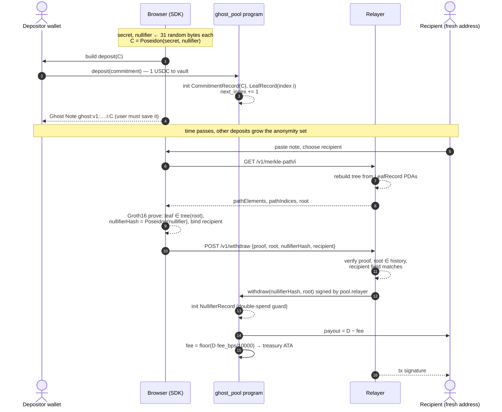
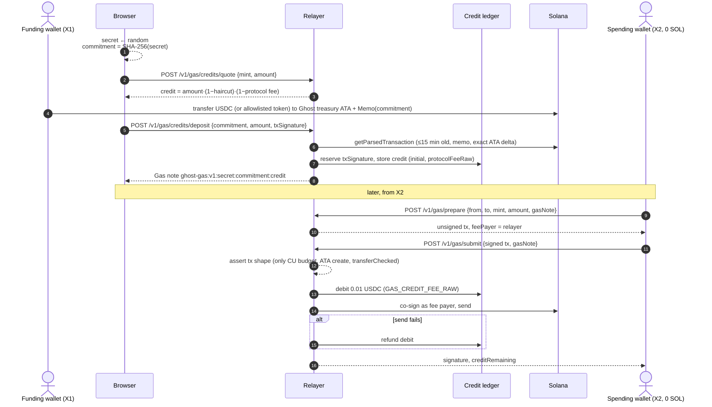
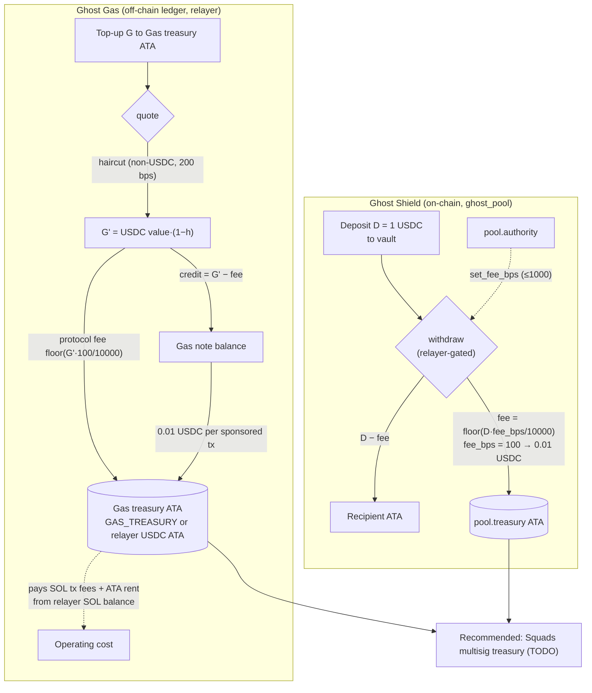
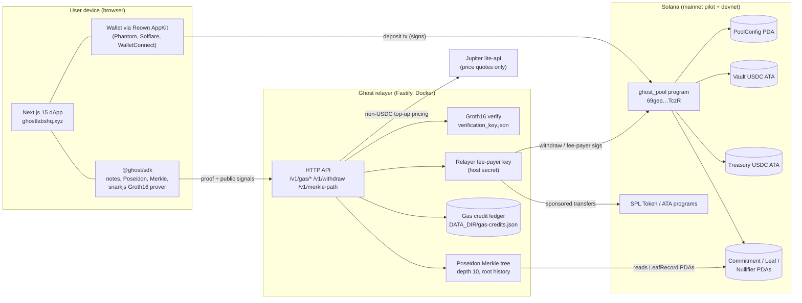
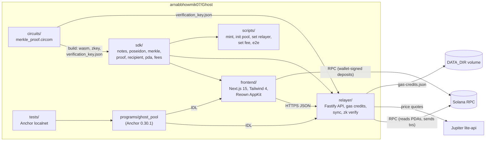

# Ghost

**Prepaid gas credits for Solana.** A primary wallet tops up once. An alt wallet signs token transfers with **0 SOL**. Ghost pays the network fee and debits the credit — without ever sending SOL from the primary wallet to the alt.

| | |
|---|---|
| **Site** | [ghostlabshq.xyz](https://ghostlabshq.xyz) |
| **Docs** | [ghostlabshq.xyz/docs](https://ghostlabshq.xyz/docs) |
| **Litepaper** | [ghostlabshq.xyz/litepaper.pdf](https://ghostlabshq.xyz/litepaper.pdf) |
| **Pitch deck** | [ghostlabshq.xyz/pitch-deck](https://ghostlabshq.xyz/pitch-deck/index.html) |
| **Brand kit** | [ghostlabshq.xyz/brand-kit](https://ghostlabshq.xyz/brand-kit/index.html) |
| **llms.txt** | [ghostlabshq.xyz/llms.txt](https://ghostlabshq.xyz/llms.txt) |
| **Demo video** | [youtu.be/QTJv78KeQqM](https://youtu.be/QTJv78KeQqM) |
| **X** | [x.com/ghostlabshq](https://x.com/ghostlabshq) |
| **Telegram** | [t.me/ghostlabshq_xyz](https://t.me/ghostlabshq_xyz) |
| **Discord** | [discord.gg/XSPszRsTZY](https://discord.gg/XSPszRsTZY) |
| **LinkedIn** | [linkedin.com/company/ghostlabshq](https://www.linkedin.com/company/ghostlabshq) |
| **GitHub** | [github.com/arnabbhowmik07/Ghost](https://github.com/arnabbhowmik07/Ghost) |
| **Ambassador form** | [Google Form](https://forms.gle/6WNNsDzP1eyA3vhf9) |
| **License** | MIT |

> **Gas-first on mainnet.** Ghost Shield (optional private USDC pool) stays off until the pool program is deployed. Gas does not need it.

---

## Table of contents

1. [What this is and who it's for](#1-what-this-is-and-who-its-for)
2. [Story & inspiration](#2-story--inspiration)
3. [Problem](#3-problem)
4. [Solution](#4-solution)
5. [How it works](#5-how-it-works)
6. [Target users](#6-target-users)
7. [Features](#7-features)
8. [Addresses & revenue](#8-addresses--revenue)
9. [Sponsor & partner integrations](#9-sponsor--partner-integrations)
10. [Tech stack](#10-tech-stack)
11. [Architecture](#11-architecture)
12. [Competitors](#12-competitors)
13. [Go to market](#13-go-to-market)
14. [Business model](#14-business-model)
15. [Roadmap](#15-roadmap)
16. [Team](#16-team)
17. [Run locally](#17-run-locally)
18. [Verify / tests](#18-verify--tests)
19. [Repo layout](#19-repo-layout)
20. [Security notes](#20-security-notes)
21. [License](#21-license)
22. [Previous hackathon wins](#22-previous-hackathon-wins)
23. [Previous grants taken](#23-previous-grants-taken)
24. [Public tweet links](#24-public-tweet-links-mentioned-by-reputable-ogs)
25. [Token flywheel](#25-token-flywheel--after-token-launch)
26. [Token details](#26-token-details--after-token-launch)

---

## 1. What this is and who it's for

**Ghost Gas** is prepaid fee sponsorship for Solana SPL transfers.

- Someone with funds (a **primary wallet**) deposits USDC — or another allowed asset priced to USD — into Ghost and receives a **gas note** (`ghost-gas:v1:…`).
- A second wallet (an **alt wallet**, often with **zero SOL**) attaches that note, picks a token and recipient, and signs.
- Ghost's relayer is `feePayer` (pays SOL on-chain) and **debits a flat USDC fee** from the note.

Tokens move **directly** from the alt wallet to the recipient. They never pass through Ghost.

**Who it's for:** people who run multiple wallets, want alt wallets to spend tokens without a public SOL top-up from their main wallet, builders who need gasless UX for users holding only tokens, and privacy-minded users who treat the primary→alt SOL handoff as the leak that ruins compartmentalization.

**Who it's not for (yet):** anyone expecting a trustless mixer, fully on-chain credit accounting, or audited production custody. The gas ledger is **relayer-operated**. Start small.

---

## 2. Story & inspiration

Ghost started as a weekend build: a ZK privacy suite on BNB Chain where a wallet with **zero gas** could withdraw stablecoins, with fees settled in USDC. That product won **BNB Hack Bengaluru**.

The hard lesson from that build carried to Solana: **the fee asset is the anonymity set killer.** On Solana everyone needs SOL. The moment a primary wallet sends SOL to an alt so it can move tokens, the graph links them — before the “real” transfer even happens.

So this repo ships **Ghost Gas first**: break that funding link with prepaid credit. Optional **Ghost Shield** (fixed 1 USDC private pool + ZK withdraw) remains in the codebase as a secondary path, ported from the BNB Ghost Privacy Suite lean MVP, and stays disabled on mainnet until the program is live.

Inspiration stack: paymasters / account abstraction on EVM, Solana feePayer patterns, Circom Groth16 pools, and the simple product rule that everyday UX should not require the user to understand ZK.

---

## 3. Problem

On Solana, every send needs SOL for fees.

1. An alt wallet can hold tokens and still be stuck with no SOL.
2. Someone (usually a primary wallet) must send SOL first.
3. That funding transfer is public. Observers connect funder → spender.

Privacy and operational hygiene break **before** the token transfer. Wallets, trading alts, and “quiet” addresses all hit the same wall.

Existing answers are awkward: keep dust SOL everywhere, bridge through CEXes, use ad-hoc fee sponsors that still require accounts/logins, or accept the link and hope nobody looks.

---

## 4. Solution

**Prepay Ghost. Never fund the alt with SOL.**

| Role | Does |
|---|---|
| Primary wallet | Pays USDC (or allowed multi-asset top-up) once → receives a gas note |
| Alt wallet | Holds tokens, attaches the note, signs the SPL transfer (0 SOL OK) |
| Ghost relayer | Pays Solana fee as `feePayer`, debits flat USDC from the note |
| Recipient | Receives tokens straight from the alt |

No SOL handoff from primary → alt. That link never has to exist.

Secondary product: **Ghost Shield** — deposit fixed 1 USDC, keep a Ghost Note, ZK withdraw to a fresh address. Optional private on-ramp; not required for Gas.

---

## 5. How it works


<details>
<summary>Mermaid source</summary>



</details>


<details>
<summary>Mermaid source</summary>



</details>

```
Primary ── USDC / allowed asset ──► Ghost treasury
                │
                └── gas note (ghost-gas:v1:…)

Alt + gas note ── sign SPL TransferChecked ──► Recipient
                      │
                      └── Ghost feePayer pays SOL
                          Ghost debits flat fee from note
```

**Top-up (Credits)**

1. Connect primary wallet at `/app/credits`.
2. Deposit USDC to the Ghost treasury (memo / freshness / allowlist enforced), or another allowed mint priced via Jupiter quote with a haircut.
3. Relayer credits an off-chain note and returns `ghost-gas:v1:…`.
4. Save the note. Whoever holds it can spend the credit.

**Sponsored send**

1. At `/app/send`, connect the alt wallet, paste/select the gas note.
2. Choose mint, amount, recipient.
3. Client calls `POST /v1/gas/prepare` → user signs → `POST /v1/gas/submit`.
4. Relayer verifies the note balance, reserves the flat fee, checks a strict instruction allowlist (TransferChecked + optional compute budget + single ATA create), signs as feePayer, submits, and finalizes the debit.

**APIs**

| Piece | Path |
|---|---|
| Top up | `POST /v1/gas/credits/deposit` · UI `/app/credits` |
| Sponsor | `POST /v1/gas/prepare` + `/v1/gas/submit` (both need `gasNote`) · UI `/app/send` |
| Shield (optional) | `/app/deposit`, `/app/withdraw`, `/app/notes` |

---

## 6. Target users

- **Multi-wallet operators** who keep trading / ops / personal wallets separate
- **Token-only wallets** that receive airdrops or payroll SPLs but have no SOL
- **Privacy-conscious users** who refuse the primary→alt SOL graph edge
- **Product builders** who want “sign and send” UX without forcing users to buy SOL first
- **Teams / treasuries** that want to prepay fee credit for operators without funding each key

---

## 7. Features

- Prepaid gas notes (`ghost-gas:v1`)
- Sponsored SPL transfers with **0 SOL** on the signer
- Flat USDC debit per send (default **0.01 USDC**)
- Multi-asset credit top-ups via live Jupiter USD liquidity (haircut applied)
- Strict deposit verification (transfer ix, ATA-only, freshness, pending-tx reservation)
- Fail-closed deposit allowlist; risky Token-2022 rejected
- Strict sponsored instruction policy + fee caps
- Atomic ledger writes (temp file + rename)
- Debit reserve before broadcast
- Rate limits (`GAS_MAX_PER_HOUR`)
- Reown AppKit / WalletConnect (Phantom, Solflare, QR, …)
- Optional Ghost Shield private pool (Devnet / local; off on mainnet by default)
- Docker Compose hosting for UI + relayer

---

## 8. Addresses & revenue

### Production / product

| | |
|---|---|
| UI | https://ghost.arnabbhowmik.in |
| Relayer API | https://ghost-api.arnabbhowmik.in |
| Circle USDC (mainnet) | `EPjFWdd5AufqSSqeM2qN1xzybapC8G4wEGGkZwyTDt1v` |
| Flat gas debit | `GAS_CREDIT_FEE_RAW=10000` → **0.01 USDC** per sponsored send |
| Multi-asset haircut | configurable bps on Jupiter `outAmount` (credit less than quoted) |

Mainnet pool program is **not** required for Gas. Relayer pubkey is the funded feePayer for the host (set at deploy time; do not publish private keys).

### Devnet (Shield / pool demos)

| | Address |
|---|---|
| Program | [`69gepJRrDXGgaKExaUHWmDjtLe4LHxTrNiGVzBGoTczR`](https://explorer.solana.com/address/69gepJRrDXGgaKExaUHWmDjtLe4LHxTrNiGVzBGoTczR?cluster=devnet) |
| Mock USDC | [`GLfrBSjkzFQZJrWEcWfA9j1yapabGYTwdcNJKAgqWeCt`](https://explorer.solana.com/address/GLfrBSjkzFQZJrWEcWfA9j1yapabGYTwdcNJKAgqWeCt?cluster=devnet) |
| Pool | [`DbMcqri6ScZSnQBpDATapaWWUfUGTiytyMuzZrZKpZCr`](https://explorer.solana.com/address/DbMcqri6ScZSnQBpDATapaWWUfUGTiytyMuzZrZKpZCr?cluster=devnet) |
| Hosted Devnet relayer | [`EWpDhR9kvBtPSwhiGbqarjxsy97nJSE784HjzkQ9Lsxf`](https://explorer.solana.com/address/EWpDhR9kvBtPSwhiGbqarjxsy97nJSE784HjzkQ9Lsxf?cluster=devnet) |

See `deployments.json` for explorer links to deploy / deposit / withdraw txs.

### Revenue (product)

- Flat USDC fee per sponsored send (primary margin vs SOL paid)
- Optional haircut on non-USDC deposits
- Future: partner fee shares, higher-tier credit packs, Shield fees when enabled

Treasury USDC lands in the relayer-associated USDC ATA (or `GAS_TREASURY` override).


<details>
<summary>Mermaid source</summary>



</details>

---

## 9. Sponsor & partner integrations

| Integration | Role |
|---|---|
| **Solana feePayer** | Relayer sponsors compute + signature fees |
| **Circle USDC** | Settlement asset for credits and flat debits |
| **Jupiter** | Live quotes for multi-asset → USDC credit pricing |
| **Reown AppKit** | Wallet connect (WalletConnect project id) |
| **Helius / QuickNode / Triton** (ops) | Paid RPC recommended for mainnet |
| **Docker** | Production packaging for UI + relayer |

Open to wallet embeds, bot / Telegram send flows, and treasury “credit packs” for teams. Contact via the live site / GitHub issues.

---

## 10. Tech stack

| Layer | Stack |
|---|---|
| Frontend | Next.js (App Router), TypeScript, Reown AppKit |
| Relayer | Fastify, `@solana/web3.js`, SPL Token |
| SDK | Note encode/decode, Poseidon / Merkle / proofs (Shield) |
| Program (Shield) | Anchor 0.30 / Solana program `ghost_pool` |
| Circuits (Shield) | Circom, Groth16, snarkjs |
| Pricing | Jupiter quote API |
| Ops | Docker Compose, Node 20+, paid RPC |

---

## 11. Architecture


<details>
<summary>Mermaid source</summary>



</details>


<details>
<summary>Mermaid source</summary>



</details>

```
┌─────────────┐     USDC / SPL      ┌──────────────────┐
│  Primary    │ ──────────────────► │  Treasury ATA    │
│  wallet     │ ◄── gas note ────── │  + credit ledger │
└─────────────┘                     │  (relayer files) │
                                    └────────┬─────────┘
┌─────────────┐   prepare/submit             │
│  Alt wallet │ ◄────────────────────────────┤
│  (0 SOL OK) │   feePayer signature         │
└──────┬──────┘                              │
       │ TransferChecked                     │
       ▼                                     ▼
┌─────────────┐                     ┌──────────────────┐
│  Recipient  │                     │  Solana RPC      │
│  (tokens)   │                     │  (relayer pays)  │
└─────────────┘                     └──────────────────┘
```

**Trust split (honest):**

| Concern | Enforced by |
|---|---|
| SPL transfer correctness | On-chain Token program + user signature |
| Who pays SOL | Relayer key as `feePayer` |
| Gas credit balance / debit | **Off-chain relayer ledger** |
| Deposit replay / freshness | Relayer verification + reservations |
| Shield nullifier (when on) | On-chain nullifier PDA |
| Shield Merkle / Groth16 (MVP) | Relayer-assisted; malicious relayer can drain vault |

Gas is modular: it does not depend on Shield being deployed.

---

## 12. Competitors

| Approach | Gap vs Ghost Gas |
|---|---|
| Manual SOL top-ups | Creates the funding graph edge |
| Generic fee sponsors / paymasters | Often account-bound, mint-limited, or not prepaid-note portable |
| CEX withdraw dust SOL | Custody + KYC + still links patterns |
| Full privacy pools / mixers | Different job; heavier trust/compliance surface; not “send any SPL today” |
| Other Solana privacy suites | Broad privacy stacks; Ghost Gas is deliberately narrow: **prepaid fee credit for alt sends** |

Ghost can sit *beside* privacy pools: use Gas so the spending key never needs a SOL umbilical from the funding key.

---

## 13. Go to market

1. **Ship Gas-first mainnet** with Shield off and tight allowlists.
2. **Content:** docs page + landing flow (primary tops up → alt signs → Ghost pays).
3. **Distribution:** Solana wallet users, multi-account traders, builder Twitter / Telegram, hackathon demos.
4. **Integrations:** wallet deeplinks, bot “send with note”, treasury credit packs.
5. **Trust ladder:** publish addresses, open-source policy, start-small UX copy, later audits + on-chain credit hardening.
6. **Shield** as optional private on-ramp once program + ops are ready.

---

## 14. Business model

- **Per-send fee** in USDC micro-units (default 0.01 USDC)
- **Deposit haircut** on non-USDC top-ups
- **SOL float** managed by the operator (feePayer inventory)
- Future: volume tiers, partner rev-share, Shield withdraw fees, B2B prepaid packs

Costs: RPC, SOL for sponsorship, hosting, support. Margin = fee − SOL − ops − credit risk.

---

## 15. Roadmap

| Phase | Focus |
|---|---|
| **Now** | Gas-first mainnet, multi-asset deposits, hardened sponsor policy, public repo |
| **Next** | On-chain or replicated credit commitments; clearer treasury / ops dashboards; partner embeds |
| **Shield** | Deploy pool on mainnet when ready; turn `NEXT_PUBLIC_SHIELD_ENABLED=true`; on-chain Groth16 path |
| **Later** | Audits, rate-limit / risk engines, mobile-friendly note backup UX, token (if/when) |

---

## 16. Team

**Ghost (Solana)** is built and operated by **[Arnab Bhowmik](https://github.com/arnabbhowmik07)** ([LinkedIn](https://www.linkedin.com/in/bhowmikarnab)).

The original **Ghost Privacy Suite** (BNB Hack Bengaluru) was built with:

- Ishika Bhoyar
- Saish Korgaonkar
- Om Lanke  
  with guidance from Lucas Liao

---

## 17. Run locally

**Prerequisites:** Node 20+, Rust 1.79 (for program builds), Solana CLI 1.18.x, Anchor 0.30.1. Circom only if you rebuild circuits.

```bash
npm install

# Relayer
cp relayer/.env.example relayer/.env
# set RELAYER_KEYPAIR_PATH, USDC_MINT, PROGRAM_ID, RPC_URL, ALLOWED_ORIGINS
# GAS_ENABLED=1

# Frontend
cp frontend/.env.local.example frontend/.env.local
# NEXT_PUBLIC_USDC_MINT, NEXT_PUBLIC_PROGRAM_ID, NEXT_PUBLIC_RPC_URL
# NEXT_PUBLIC_RELAYER_URL=http://127.0.0.1:3001
# NEXT_PUBLIC_WALLETCONNECT_PROJECT_ID from https://dashboard.reown.com
# NEXT_PUBLIC_SHIELD_ENABLED=false for Gas-only

npm run relayer    # :3001  GET /health
npm run frontend   # :3000
```

**Mainnet host (Gas-first):**

```bash
cp .env.mainnet.example .env
# paid RPC, Circle USDC, funded .keys/relayer-mainnet.json
npm run mainnet:preflight
docker compose build --no-cache && docker compose up -d
```

**Localnet Shield / program** (optional):

```bash
npm run circuits:ptau && npm run circuits:build
npm run build:program
npm run test:e2e
```

Never commit `.env`, keypairs, or `NEXT_PUBLIC_*` secrets. Dev wallet injection is for headless demos only.

---

## 18. Verify / tests

```bash
npm test                 # SDK + relayer unit tests
npm run test:anchor      # program smoke (build + anchor test)
npm run test:e2e         # localnet e2e (validator + withdraw path)
npm run mainnet:preflight
curl -s https://ghost-api.arnabbhowmik.in/health
```

Manual smoke: `/app/credits` top-up → copy note → `/app/send` sponsored transfer → confirm debit and explorer feePayer.

---

## 19. Repo layout

```
Ghost/
├── programs/ghost_pool/   # Anchor program (Shield)
├── circuits/              # Circom + build scripts
├── sdk/                   # Notes, Poseidon, Merkle, proofs, gas-note
├── relayer/               # Fastify: gas credits, sponsor, ZK gate
├── frontend/              # Next.js UI (landing, docs, /app/*)
├── scripts/               # Mint, initialize, e2e, mainnet preflight
├── tests/                 # Anchor localnet tests
├── keys/                  # Program address keypair (not a funded wallet)
├── docker-compose.yml
├── deployments.json
├── .env.mainnet.example
└── AGENTS.md              # Short agent / contributor product map
```

Key Gas files: `sdk/src/gas-note.ts`, `relayer/src/gas-credits.ts`, `relayer/src/gas.ts`, `frontend/lib/gas.ts`, `frontend/lib/gas-credits.ts`.

---

## 20. Security notes

**Read this before depositing real funds.**

- Gas credit balances are **relayer-trusted**. A malicious or compromised relayer can lie about balances, refuse service, or mishandle treasury.
- Relayer key is **production custody** (pays SOL; controls credit writes). Protect like a hot wallet with limited float.
- Sponsored txs are allowlisted (TransferChecked-focused). Do not loosen without review.
- Deposits: freshness, ATA checks, pending-sig reservation, fail-closed mint allowlist.
- Ledger writes use atomic rename; still back up `DATA_DIR`.
- Jupiter pricing: oracle / liquidity / haircut risk on multi-asset deposits.
- Shield MVP: **malicious relayer can drain the vault** (proof verification is relayer-gated in the lean path). Devnet / demo until hardened.
- `ALLOW_MOCK_PROOF=1` is ignored unless RPC is localhost.
- Unaudited MVP. Start small. Report issues via GitHub.

---

## 21. License

[MIT](./LICENSE) © 2026 Ghost Privacy Suite

---

## 22. Previous hackathon wins

| Event | Project | Outcome |
|---|---|---|
| **BNB Hack Bengaluru** | [Ghost Privacy Suite](https://github.com/Arnab-Afk/BNB) (BNB Chain: Groth16 + ERC-4337 paymaster, USDC gas) | **Winner** — [Arnab's write-up](https://www.linkedin.com/posts/bhowmikarnab_bnbhack-winner-bnbchain-activity-7434691733424218112-dP7q) · [teammate post](https://www.linkedin.com/posts/ishikabhoyar_bnbhack-winner-web3-activity-7434699512390017024-B6kw) |

This Solana repo is the Gas-first continuation of that line of work.

---

## 23. Previous grants taken

**None to date** for Ghost (BNB or Solana). No Solana Foundation / Colosseum grant has been taken for this project. This section will be updated if that changes.

---

## 24. Public tweet links (mentioned by reputable OGs)

*Optional — add as they land.*

| Date | Who | Link | Note |
|---|---|---|---|
| — | — | — | TBD |

---

## 25. Token flywheel — *after token launch*

> **Placeholder.** No Ghost token is live for this product. Do not invent one.

Intended section after launch (draft shape only):

- Fee discounts / priority sponsorship for stakers
- Credit pack purchases
- Partner incentive budgets
- Clear non-promises: token ≠ credit solvency; relayer trust remains until on-chain accounting

---

## 26. Token details — *after token launch*

> **Placeholder.** Fill after TGE.

| Field | Value |
|---|---|
| Ticker | TBD |
| Mint | TBD |
| Decimals | TBD |
| Distribution | TBD |
| Utility | TBD |
| Links | TBD |

---

**Try it:** [ghostlabshq.xyz](https://ghostlabshq.xyz) · **Docs:** [/docs](https://ghostlabshq.xyz/docs) · **Litepaper:** [/litepaper.pdf](https://ghostlabshq.xyz/litepaper.pdf)
